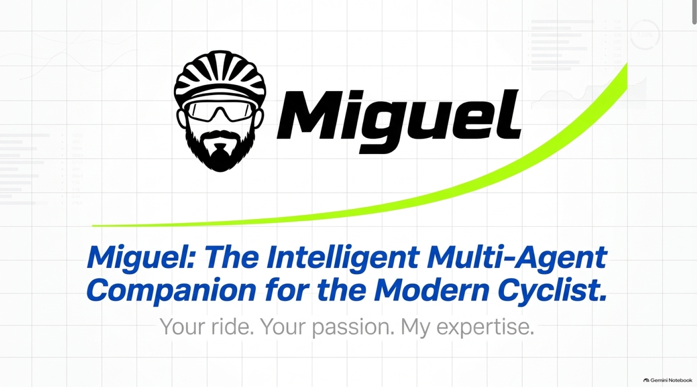

<h1 align="center">
    <picture>
        <source
            media="(prefers-color-scheme: dark)"
            srcset="./.github/assets/miguel-cyclist-logo-dark.png">
        
    </picture>
</h1>

<h3 align="center">
  <i>Your ride. Your passion. My expertise. 🚴</i>
</h3>

<p align="center">
  Your intelligent cycling companion.
  <br>
  From the professional peloton to your garage, everything cycling under one roof.
</p>

---

## Meet Miguel

**Miguel** is an intelligent cycling companion built for everyone who lives and breathes cycling — from casual weekend riders and aspiring enthusiasts to seasoned cyclists and followers of professional racing.

Think of Miguel as your personal cycling mechanic, race analyst, nutrition guide, and training companion, all rolled into one.

Whether you want to understand the latest developments in professional cycling, learn how to maintain your road bike, troubleshoot a mechanical issue, plan your nutrition for a long ride, or simply settle a cycling-related question, Miguel is here to help.

Cycling is a world of its own, with its races, equipment, technology, techniques, science, and traditions. Miguel aims to bring all of that knowledge together in one intelligent, conversational experience.


## Development Status

<blockquote>
  <strong>🚧 Miguel is currently learning!</strong>
  <br><br>
  Miguel is under active development, building his cycling knowledge, refining his capabilities, and learning to become a well-rounded cycling companion.
  <br><br>
  His skills across professional racing, bicycle mechanics, maintenance, nutrition, and training are being progressively developed and integrated.
  <br><br>
  <strong>Coming soon. Stay tuned for the first ride!</strong> 🚴
</blockquote>

## Project Presentation

Curious about Miguel's vision, capabilities, and long-term direction?

Take a look at the project overview presentation:

<p align="center">
  <a href=".github/docs/Miguel-Project-Overview.pdf">
    
  </a>
  <br>
  <strong><a href=".github/docs/Miguel-Project-Overview.pdf">Explore the Project Overview Presentation →</a></strong>
</p>


## What Will Miguel Know

Miguel will be designed to cover the many dimensions of cycling, including:

| Domain | What You Can Explore |
|---|---|
| **Professional Racing** | Grand Tours, Classics, stage races, teams, riders, results, race tactics, and cycling history |
| **Bike Maintenance** | Routine servicing, cleaning, lubrication, component care, and preventive maintenance |
| **Repairs & Troubleshooting** | Diagnosing mechanical problems, fixing punctures, drivetrain issues, brake adjustments, and more |
| **Bicycle Technology** | Frames, groupsets, wheels, tyres, power meters, components, and emerging technologies |
| **Nutrition & Hydration** | Fuelling strategies, hydration, electrolytes, recovery nutrition, and race-day fuelling |
| **Training & Performance** | Training principles, power zones, heart-rate training, endurance, recovery, and performance metrics |
| **Cycling Equipment** | Bikes, helmets, clothing, accessories, tools, and equipment comparisons |
| **Cycling Culture** | Cycling terminology, traditions, iconic climbs, historic rivalries, and the stories behind the sport |

## More Than a Cycling Chatbot

Miguel is envisioned as a knowledgeable companion that understands the context behind your questions.

- **Conversational Intelligence** — Ask questions naturally, explore topics, and dive deeper without having to speak in technical terminology.
- **Practical Expertise** — Get actionable guidance for maintaining, repairing, and understanding your bicycle.
- **Cycling Knowledge** — Explore the sport beyond race results, from its history and personalities to the science behind performance.
- **Contextual Assistance** — Build on previous conversations to make discussions more relevant and useful.
- **Continuous Expansion** — Grow its capabilities through specialized skills and additional knowledge sources as the project evolves.

## The Philosophy

Cycling is more than just riding a bicycle. It is a sport, a science, a mechanical pursuit, and for many, a way of life.

Miguel is built around the idea that every cycling enthusiast should have access to a knowledgeable companion who can answer their questions, explain the intricacies of the sport, and help them become better-informed cyclists.

Whether you're following the Tour de France, preparing for your next century ride, tuning your drivetrain, or wondering what to eat before a demanding climb, Miguel is ready to talk cycling.

<p align="center">
  <strong>Every ride has a story. Every question deserves an answer.</strong>
</p>

<p align="center">
  <i>Ride more. Know more. Ride better. 🚴</i>
</p>

---

## ⚙️ Setup & Usage

Follow these steps to set up and run Miguel locally.

### Prerequisites

- Python 3.13+
- [uv](https://docs.astral.sh/uv/) - Python package and project manager
- Git

### 1. Clone the Repository

```bash
git clone https://github.com/tsen09/intelligent-cycling-assistant.git
cd intelligent-cycling-assistant
```

### 2. Set Up Miguel

Run the setup command to create the virtual environment and install the required dependencies using `uv`.

```bash
./miguel.sh setup
```

Alternatively, use the shorthand:

```bash
./miguel.sh -s
```

### 3. Run Miguel

Start the application:

```bash
./miguel.sh run
```

If the project environment has not been configured, Miguel will prompt you to run the setup automatically.

By default, the application runs at:

```text
http://127.0.0.1:8000
```

### 4. Uninstall Miguel

To remove Miguel's local Python environment and generated build/cache artifacts:

```bash
./miguel.sh --remove
```

Alternatively:

```bash
./miguel.sh -r
```

Miguel will ask for confirmation before proceeding. Enter `y` to confirm or `n` to cancel.

**Note:** Uninstallation preserves your source code, Git history, documentation, and shared system dependencies. It does not uninstall Python, `uv`, or PostgreSQL.

### CLI Reference

| Command | Description |
|---|---|
| `./miguel.sh setup` | Set up the project environment |
| `./miguel.sh -s` | Set up the project environment (shorthand) |
| `./miguel.sh run` | Start Miguel |
| `./miguel.sh --remove` | Uninstall Miguel |
| `./miguel.sh -r` | Uninstall Miguel (shorthand) |
| `./miguel.sh --version` | Display the installed project version |
| `./miguel.sh --help` | Display available commands |

---

## Author & Acknowledgements

**Miguel** is created and maintained by [Tanmoy Sen](https://github.com/tsen09).

If you find this project useful, feel free to star the repository, share it, or build upon it in accordance with the MIT License.

If you use, modify, or distribute Miguel, attribution to the original project and its author is appreciated.

<p align="center">
  Made with ❤️ and a passion for cycling.
  <br>
  <a href="https://github.com/tsen09">GitHub: @tsen09</a>
</p>

---

## Open Source & License

Miguel is an open-source project released under the **MIT License**.

You are welcome to explore the codebase, learn from it, modify it, and build upon it in accordance with the terms of the license.

Contributions, ideas, and improvements from the cycling and developer communities are always welcome.

See the [LICENSE](./LICENSE) file for the complete license terms.

<p align="center">
  <i>Built for the love of cycling. Open for everyone. 🚴</i>
</p>

